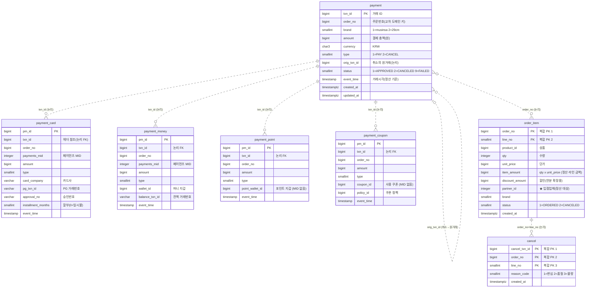
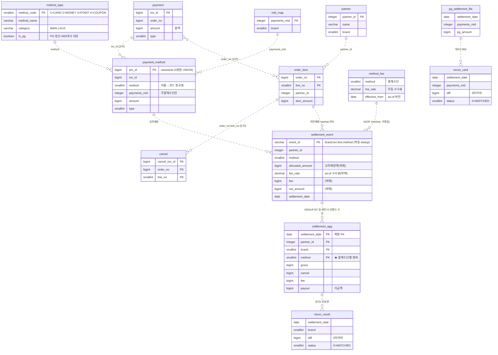

# ERD — 소스(Postgres) & 정산 canonical(DuckDB)

> Mermaid 렌더링: GitHub / VSCode(Markdown Preview Mermaid) / Obsidian 등.
> ★ **물리 FK 없음** (고트래픽 결제 원장 관행 — 락경합·샤딩·JPA 편의). 모든 연결 = 논리(점선).
> 무결성: 쓰기=앱 트랜잭션(헤더+디테일 같은 Tx) / 사후=정산 대사(고아·Σ수단=헤더 검증).

---

## 1. 2단계 소스 ERD — Postgres (paydb / orderdb)

★ 결제 도메인 = 헤더-디테일 원장: `payment`(마스터, 총액) ← 수단별 원장 4개(txn_id 논리 FK).
★ 도메인 내·도메인 간 모두 물리 FK 없음 — 논리 연결, 정합성은 앱 Tx + 정산 대사가 보장.

CDC publication: `dbz_pay`(payment + 4원장) · `dbz_order`(order_item, cancel)

---

## 2. 1단계 정산 canonical ERD — DuckDB (`transform/01_schema.sql`)

★ 소스의 수단별 4원장은 싱크에서 **UNION+정규화 → canonical `payment_method`** 로 통합된다(method 이름→SMALLINT 코드).
★ DuckDB라 물리 FK 없음 — 전부 논리 관계.

---

## 3. 소스 → canonical 매핑 요약

| 소스(Postgres) | canonical(DuckDB) | 변환 |
|---|---|---|
| payment | payment | projection (currency·status·audit 컬럼 제외, status=APPROVED 필터) |
| payment_card | payment_method | UNION + `method='CARD'→1` |
| payment_money | payment_method | UNION + `method='MONEY'→2` |
| payment_point | payment_method | UNION + `method='POINT'→3` (MID NULL) |
| payment_coupon | payment_method | UNION + `method='COUPON'→4` (MID NULL) |
| order_item | order_item | projection (product·qty·discount 등 제외) |
| cancel | cancel | projection (reason_code 제외) |
| (없음 — 정산 소유) | method_type·method_fee·partner·mid_map | 스냅샷/시드 (CDC 아님) |
