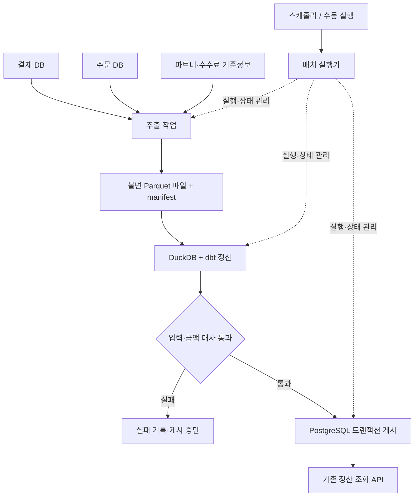

# 파일 기반 일 마감 정산 — 기본 구성 재설계안

이 문서는 파일 배치 전환 전에 작성한 **설계 기준**이다. `feat/file-batch`에서 기본 경로를 구현했으며, 현재 실행 방법·검증 절차·남은 범위는 [FILE-BATCH.md](FILE-BATCH.md)를 기준으로 한다. 아래 항목 전체가 구현됐다는 의미는 아니다.

## 1. 설계 방향

핵심 요구를 ‘변경 이벤트를 실시간으로 운반한다’에서 **‘마감 대상 데이터를 빠짐없이 확보하고, 검증된 정산 결과를 재현 가능하게 게시한다’**로 정한다.

기본 구성은 파일 추출 → DuckDB·dbt 정산 → 대사 → PostgreSQL 게시다. CDC·Kafka·Registry·Iceberg·Spark를 기본 실행 경로에서 제외하되, 이미 구현한 경로는 실시간 수집·레이크하우스 확장을 검증한 별도 구현으로 유지한다.

| 기본 요구 | 설계 판단 |
|---|---|
| 하루 단위로 파트너 정산액 계산 | 일 마감 파일을 입력으로 배치 실행 |
| 복합결제·상품 라인별 부분취소 지원 | 기존 배분·수수료 계산 모델 재사용 |
| 같은 입력으로 재실행해도 결과 동일 | 입력 파일·수수료·계산 버전을 함께 고정 |
| 실패한 작업의 재시도가 쉬워야 함 | 실행별 작업 디렉터리와 DB 상태 기록 |
| 잘못된 결과가 조회 서비스에 반영되면 안 됨 | 검증 통과 후 날짜별 결과를 트랜잭션으로 게시 |
| 추후 처리량·실시간성 요구 변경 | 입력 계약과 정산 로직의 경계를 유지 |

실제 환불·송금은 계속 범위 밖으로 둔다. ‘정산 결과 게시’와 ‘지급 실행’은 별개다.

## 2. 최소 아키텍처



| 구성 요소 | 기본안 | 이유 |
|---|---|---|
| 소스 DB | 기존 PostgreSQL의 결제·주문 DB | 현재 원장과 합성 데이터 재사용 |
| 입력·산출물 보관 | 로컬 마운트 디렉터리의 Parquet | 단일 호스트 검증에 필요한 최소 구성. 공유 저장이 필요해지면 MinIO·S3로 이동 |
| 계산 엔진 | dbt-duckdb 컨테이너 | 하나의 실행 환경에서 모델 의존성·정산·데이터 검사 수행 |
| 배치 실행 | 단일 CLI 실행기 + 스케줄러 | 추출·계산·검증·게시의 종료 코드와 실행 상태를 한 곳에서 관리 |
| 실행 상태·조회 결과 | PostgreSQL `servedb` | 실행 중복 제어와 결과 게시를 같은 DB 트랜잭션으로 관리 |
| 조회 서비스 | 기존 Spring Boot·JPA API | 기존 일자별 요약·파트너 상세 API 유지 |
| 관측 | 실행 상태, 단계별 시간·건수·대사 결과, 실패 알림 | 초기에는 배치의 완료 여부와 데이터 오류 탐지에 집중 |

로컬에서는 PostgreSQL과 배치 컨테이너, 조회 앱으로 시작한다. 파일은 컨테이너 밖에 보관해 컨테이너 종료 후에도 재실행할 수 있게 한다. 파일 백업은 별도이며, 마운트만으로 호스트 장애 복구가 보장되는 것은 아니다.

Airflow는 필수 구성에서 제외하지만 현재 DAG는 보존한다. 여러 정산 작업의 의존성·백필·운영 UI가 필요해지면 동일 CLI를 Airflow에서 호출할 수 있다.

## 3. 추출 기준: 정산일과 입력 시점을 분리

예시로 정산일 `D`는 KST 기준 `[D 00:00, D+1 00:00)`의 결제·취소 거래를 뜻한다. 실행 시각은 `D+1 02:00`으로 가정한다. 이는 설계 예시이며, 실제 확정 시각은 상류 데이터 도착 시간에 맞춰 정한다.

- **정산일:** 어떤 날짜의 거래를 계산하는가.
- **추출 시점:** 어떤 DB 상태에서 입력 파일을 만들었는가.
- **입력 버전:** 해당 정산일에 확보한 몇 번째 데이터 묶음인가.
- **결과 버전:** 어떤 입력·계산 규칙으로 산출한 결과인가.

‘02시에 실행했다’는 사실만으로 전일 데이터가 모두 도착했다고 판단하지 않는다. 상류의 마감 완료 신호 또는 해당 날짜의 거래 건수·금액과 같은 컨트롤 토탈을 확인해야 한다. 현재 프로젝트에는 이 신호가 없으므로 새로 정의할 입력 계약이다. 합성 데이터 실험에서는 데이터 생성·적재 완료를 그 신호로 사용한다.

현재 `event_time`은 timezone 없는 TIMESTAMP다. 파일 계약에서 KST로 해석할지 명시하고, 추출 시점 등 실행 메타데이터는 UTC 시각으로 저장한다. 기존 데이터의 의미를 확인하지 않고 일괄 시간 변환하지 않는다.

### DB 간 일관성

결제 헤더와 수단별 원장은 **결제 DB 내 하나의 읽기 전용 REPEATABLE READ 트랜잭션**에서 추출한다. 주문 라인과 취소 라인도 주문 DB 안에서 같은 방식으로 읽는다. 여러 연결로 병렬 추출한다면 DB별 동일 스냅샷을 공유하는 절차가 추가로 필요하므로 초기에는 순차 추출한다.

별개 DB의 두 트랜잭션이 같은 순간의 전역 스냅샷을 보장하지는 않는다. 따라서 상류 마감 완료 후 추출하고, 양쪽의 참조 무결성과 컨트롤 토탈을 검사한다. 연결되지 않는 결제·취소가 있으면 게시하지 않고 입력을 다시 확보한다. 거래일 필터만으로 과거 시점의 수정 전 값을 복원할 수도 없으므로, 확보한 파일 자체를 재현의 기준으로 보관한다.

## 4. 무엇을 파일로 추출할 것인가

당일 거래만 잘라내면 과거 주문에 대한 취소를 계산할 수 없다. **계산 대상 거래와 계산에 필요한 참조 데이터를 구분**한다.

| 파일 | 포함 범위 |
|---|---|
| `payment` | D일의 정산 대상 PAY·CANCEL 거래 |
| `payment_method` | 대상 거래에 연결된 수단별 원장. 추출 SQL의 UNION ALL로 카드·머니·포인트·쿠폰 통합 |
| `original_payment` | 취소의 `orig_txn_id`가 가리키는 원결제. 필요하면 D 이전 거래 포함 |
| `original_payment_method` | 취소 배분에 필요한 원결제 수단 구성 |
| `order_item` | 대상 결제·취소가 참조하는 주문의 상품 라인 |
| `cancel` | 대상 취소 거래의 취소 라인 |
| `partner`, `method_fee`, `mid_map` | 해당 실행에 필요한 기준정보와 적용 이력 |

예를 들어 5월 1일 결제의 취소가 5월 20일 발생하면, 20일 입력에는 취소 거래와 1일 원결제의 수단 구성을 함께 담는다. 원결제는 참조용으로만 사용해 20일 매출에 다시 합산하지 않는다.

현재 정산 SQL은 원결제 수단을 `order_no`로 조인한다. 파일 기반 일 배치에서는 `orig_txn_id`를 기준으로 원거래를 명시적으로 연결하고, 정산 대상과 참조 거래를 구분하도록 수정해야 한다. 같은 주문의 재결제가 섞이는 문제도 이 경계에서 검증한다.

수단별 원장의 `pm_id`가 서로 다른 테이블에서 겹칠 수 있으므로 공통 키를 `(method, pm_id)`로 정의한다. 상품·취소의 복합키와 거래 ID의 유효 범위도 파일 계약에 포함한다. 같은 정산 라인·수단으로 여러 원장 행이 합쳐질 경우 먼저 합산해 배분의 중복을 막는다.

### 파일 형식과 추출 방식

Parquet의 정수 금액·날짜·컬럼 타입을 고정한 스키마를 사용한다. 내보내기는 서버 측 커서 또는 COPY 스트림으로 읽고 정해진 행 묶음 단위로 파일을 작성한다. 전체 데이터를 애플리케이션 메모리에 한 번에 올리지 않는다.

초기에는 D일 대상과 참조 데이터를 매번 새로 추출하는 **일자 범위 전체 추출**을 사용한다. `_op`·LSN·watermark는 이 입력 계약에 필요하지 않다. 기존 CDC staging을 그대로 쓰는 것이 아니라 Parquet용 staging을 별도로 만든다.

## 5. 입력 묶음의 완료와 불변성

```text
settlement/
  input/date=2026-05-20/bundle=<UUID>/
    payment/part-000.parquet
    payment_method/part-000.parquet
    original_payment/part-000.parquet
    original_payment_method/part-000.parquet
    order_item/part-000.parquet
    cancel/part-000.parquet
    masters/...
    manifest.json
  runs/run=<UUID>/attempt=1/
    work.duckdb
    settlement_event.parquet
    settlement_agg.parquet
    checks.json
    execution.log
```

실행기는 디렉터리의 모든 파일을 glob으로 읽지 않고 **manifest에 명시된 파일만 읽는다.** 이렇게 해야 작성 중 파일이나 이전 실행의 잔여 파일이 섞이지 않는다.

| manifest 항목 | 용도 |
|---|---|
| `schema_version`, `bundle_id`, `settlement_date`, `timezone` | 입력 형식과 정산 범위 식별 |
| DB별 `extraction_started_at`, `extraction_finished_at` | 추출 시점 기록. 두 DB가 같은 스냅샷이라는 의미는 아님 |
| `files`: 경로·행 수·바이트 수·SHA-256 | 파일 누락·변조·부분 업로드 검출 |
| 테이블별 건수·거래 유형별 금액 합 | 추출 결과와 입력 파일 대조 |
| 상류 마감 참조·컨트롤 토탈 | 대상 데이터 완전성 검증 근거 |
| 기준정보 버전·파일 목록 | 수수료·파트너 변경과 무관한 재현 |

임시 디렉터리에 파일을 완성하고 체크섬을 계산한 뒤 manifest를 마지막으로 확정한다. 로컬에서는 같은 파일시스템 안의 rename으로 최종 파일을 노출한다. 오브젝트 스토리지로 옮길 경우 파일별 업로드를 완료한 뒤 manifest를 마지막 객체로 게시한다. 디렉터리 rename을 S3의 원자 동작으로 가정하지 않는다.

완료된 bundle은 덮어쓰지 않는다. 재추출은 새 bundle을 만든다. 파일 체크섬은 바이트 무결성 검사이며, Parquet 인코딩 등이 달라진 파일 사이의 논리적 데이터 동일성 증명으로 사용하지 않는다.

## 6. 계산과 업무 규칙

입력 범위가 날짜 단위로 제한되므로 초기에는 dbt 모델을 전체 재생성한다. 원장 전체를 매번 읽는 방식은 아니며, D일의 대상과 필요한 참조 데이터만 처리한다. 실행·시도별 DuckDB 파일을 분리해 동시에 다른 날짜를 계산해도 파일 쓰기가 충돌하지 않게 한다.

```text
파일 검사
  → staging: 스키마·키·참조 관계 검사
  → 대상 거래와 주문 라인 연결
  → 상품가 비율 배분
  → 원결제 수단 비율 배분
  → 유효 수수료 적용
  → 이벤트·파트너 집계
  → 대사
```

기존 로직에서 금액 배분·잔액 보정·수수료 이력·집계 단위를 재사용한다. 다음 기준은 기본안의 업무 계약으로 명시한다.

- 금액은 원 단위 정수로 저장하고, 비율 계산은 범위를 정한 DECIMAL을 사용한다. 기존 DOUBLE 중간 계산은 정수 경계 테스트 후 교체한다.
- 잔액 보정은 정해진 키 정렬의 마지막 라인·수단에 적용해 실행 순서에 따른 변화를 막는다.
- 현재 집계식을 따르는 기본안은 `payout = gross - cancel - fee`이며 fee는 PAY에서만 차감한다. 취소 시 수수료 반환은 별도 정책 변경으로 취급한다.
- 부분취소의 초기 범위는 기존 모델과 같은 ‘취소 대상 상품 라인’이다. 동일 라인의 수량·금액 단위 반복 취소까지 지원하려면 취소 명세에 금액·수량을 추가하고 누적 한도를 검증해야 한다.
- 정산 대상 상태를 명시한다. 승인 후 나중에 취소된 PAY의 이력을 상태 필터로 제거하면 안 되므로, 승인 사건의 유효성과 별도 CANCEL 사건을 구분한다. 현재 합성 데이터에서 확인하지 않은 상태 조합은 게시 전에 차단한다.

## 7. 멱등성: 같은 입력 재시도와 재정산을 구분

**같은 입력의 재시도는 같은 논리 실행을 재개하고, 입력·규칙이 바뀌면 새 결과 버전을 만든다.**

```text
run_key = hash(
  settlement_date,
  확정된 manifest의 식별값·파일 체크섬,
  정산 코드·이미지 버전,
  계산 정책 버전
)
```

수수료 등의 기준정보 파일은 manifest에 포함한다. 재시도 때 소스 DB나 최신 수수료 테이블을 다시 읽지 않는다. 새로 추출한 bundle은 동일한 내용일 수 있어도 별도 입력으로 취급한다. 파일명이 같은 것만으로 재사용을 결정하지 않는다.

| 상황 | 처리 |
|---|---|
| 동일 `run_key`가 이미 게시 완료 | 기존 게시 결과 반환, 추가 쓰기 없음 |
| 동일 `run_key`가 실행 중 | 중복 실행 거부 또는 기존 상태 반환 |
| 동일 `run_key`가 실패 | 같은 bundle로 새 attempt 실행 |
| 원장·기준정보·계산 정책 변경 | 새 `run_key`와 결과 버전 생성 |
| 같은 날짜의 다른 입력이 동시에 실행 | 게시 시 날짜 잠금·기대 버전 비교로 오래된 결과의 덮어쓰기 방지 |

`settlement_run`에는 `run_id`, `run_key UNIQUE`, 정산일, bundle 참조, 코드·정책 버전, 상태, 오류를 기록한다. `settlement_attempt`에는 시도 번호, 소유 토큰, heartbeat, 단계별 시간을 기록한다.

상태는 `READY → RUNNING → VALIDATED → PUBLISHED`이며 오류는 `FAILED`로 기록한다. 중단된 작업은 heartbeat 만료 후 조건부 갱신으로 새 소유 토큰을 발급해 재시도한다. 이전 실행이 뒤늦게 살아나도 현재 소유 토큰을 제시하지 못하면 상태 갱신과 게시를 거부한다. 단순 ‘실행 중 플래그’만 남겨 영구 잠금이 되는 상황을 피한다.

## 8. 대사를 게시 조건으로 만들기

검증 결과를 출력하는 데서 끝내지 않고, 필수 검사 실패는 실행 실패로 반환한다. 통과 여부와 상세 차이는 `checks.json` 및 실행 DB에 남긴다.

| 단계 | 필수 검사 | 실패 시 처리 |
|---|---|---|
| 파일 입력 | manifest 존재, 모든 파일 체크섬·건수·스키마 일치 | 계산 시작 금지 |
| 대상 완전성 | 상류 마감 신호, 대상 거래 건수·금액 컨트롤 토탈 일치 | 재추출 또는 입력 확인 대기 |
| 관계·키 | 중복 키, 헤더 없는 수단, 주문 없는 결제, 원거래·취소 라인 누락 | 게시 금지 |
| 배분 | 각 거래의 수단 합=헤더, 각 거래·라인의 배분 합 보존 | 게시 금지 |
| 업무 규칙 | 유효 파트너·수수료 존재, 분모 양수, 정의하지 않은 거래 상태·취소 조합 없음 | 게시 금지 |
| 집계 | PAY 합=gross, CANCEL 합=cancel, payout 계산식 일치 | 게시 금지 |
| 게시 후보 | 집계 키 유일성, 금액·건수·날짜 범위가 검증 산출물과 일치 | 트랜잭션 게시 금지 |

중복은 무조건 `DISTINCT`로 지우지 않는다. 서로 다른 거래가 키 설계 오류로 겹친 것일 수 있으므로 중복 원인을 확인하게 한다. 같은 소스에서 추출 파일의 합계를 만든 것만으로 누락된 업무 사건까지 탐지할 수는 없으므로, 상류 마감 기준과 참조 검사를 함께 사용한다.

현재 모의 PG 파일은 같은 결제 원장에서 생성된다. 이를 외부 기관과의 독립 대사로 간주하지 않는다. 실제 PG 대사는 별도 파일 수신과 MID 매핑·거래일 차이·수수료 정책을 정의한 뒤 확장한다.

## 9. 결과 게시: 전체 TRUNCATE 대신 날짜별 교체

현재 조회 API를 유지하기 위해 기본안은 기존 `settlement_agg`를 계속 사용한다. 전체 테이블을 비우는 대신 **해당 정산일만 트랜잭션으로 교체**한다.

1. 검증된 결과를 `run_id`별 게시 후보 테이블에 적재한다. 후보는 API에서 조회하지 않는다.
2. DB에서 후보의 키·건수·금액 합계와 검증 산출물을 다시 비교한다.
3. `settlement_publication`의 해당 날짜 행을 잠근다. 최초 행 생성도 날짜 PK로 직렬화한다.
4. 실행의 소유 토큰·검증 상태·정산일을 검사하고, 요청한 `expected_revision`이 현재 게시 버전과 같은지 확인한다.
5. 같은 트랜잭션에서 해당 날짜의 기존 집계를 삭제하고 후보를 삽입한다.
6. 게시 버전·run_id를 갱신하고 실행을 `PUBLISHED`로 변경한 뒤 커밋한다.

후보 테이블은 `(run_id, 정산일, 파트너, 브랜드, 수단)`을 유일키로 갖는다. 중간 적재 실패 시 후보를 해당 run 범위에서 다시 적재하며, 검증 완료된 후보는 게시 전까지 수정하지 않는다. 서로 다른 정산일은 서로의 결과를 삭제하지 않는다.

프로세스가 커밋 응답 전에 죽어도 게시 버전과 실행 상태가 같은 트랜잭션에 있으므로 재시도에서 완료 여부를 확인할 수 있다. 커밋 이전 실패라면 기존 결과가 유지된다. 오래된 실행이 늦게 끝나더라도 `expected_revision` 불일치로 새 결과를 덮어쓰지 못한다.

API의 한 쿼리는 기존 또는 신규 커밋 결과를 읽는다. 여러 API 요청에 걸친 동일 버전 조회까지 보장하려면 추후 응답에 revision을 노출하고 버전별 조회를 추가한다.

## 10. 지연 데이터와 마감 확정

| 사례 | 처리 원칙 |
|---|---|
| D 이전 결제의 D일 취소 | D일 취소로 계산, 원결제는 참조용 추출 |
| D일 사건이 추출 후 늦게 도착 | D일의 새 bundle로 재계산 |
| 확정 전 원장·수수료 정정 | 새 입력·정책 버전으로 재계산 후 기대 게시 버전을 지정해 교체 |
| 마감 확정 후 정정 | 자동 덮어쓰기 차단. 승인된 정정 절차로 처리 |
| 파일 추출 도중 실패 | 불완전 bundle 폐기, 새 bundle로 재추출 |
| 계산 도중 실패 | 기존 bundle을 유지하고 새 attempt로 재계산 |

초기 보완책으로 최근 N일을 재추출해 지연 입력을 확인할 수 있다. N은 임의로 고정하지 않고 허용 지연에 맞춰 설정한다. N보다 오래된 수정·삭제는 자동 탐지되지 않으므로 상류의 정정 대상 날짜 통지 또는 별도 전체 비교가 필요하다.

현재 모든 소스 테이블에 `updated_at`이 있는 것은 아니며, 하드 삭제는 변경 시각 조회만으로 찾을 수 없다. 따라서 첫 버전에서 ‘시간 watermark로 모든 변경 탐지’를 약속하지 않는다. 확정 이후 정정은 초기에는 운영 승인된 재마감으로 제한하고, 조정 이벤트를 이용한 감사 원장은 후속 범위로 둔다.

## 11. 실패 시나리오와 검증 기준

| 시나리오 | 기대 결과 |
|---|---|
| manifest 없는 디렉터리, 파일 하나 누락, 체크섬 변경 | 입력 거부, 기존 게시 결과 유지 |
| 동일 입력 연속 실행·동시 실행 | 게시 결과 중복 없음, 논리 실행은 하나 |
| 계산 중 강제 종료 후 재시도 | 같은 입력으로 동일 논리 결과, stale 소유자의 게시 거부 |
| 게시 트랜잭션 중 오류·커밋 응답 유실 | 부분 결과 미노출, 재시도에서 게시 상태 판별 |
| 같은 날짜의 서로 다른 실행이 역순 완료 | 기대 버전 불일치로 오래된 결과 게시 차단 |
| 서로 다른 날짜의 동시 실행 | 각 날짜 결과 보존, DuckDB 파일 충돌 없음 |
| 과거 원결제에 대한 오늘 취소 | 오늘 매출 중복 없음, 취소액만 오늘에 반영 |
| 원거래·수수료 누락, 1원 금액 불일치 | 검증 실패·게시 차단 |
| 100원 3분할 등 반올림 경계 | 입력 금액과 배분 합 동일, 반복 실행 값 동일 |
| 기존 CDC 입력과 동등한 파일 입력 | 타입·정렬을 정규화한 정산 결과와 금액 합계 일치 |

자동화 테스트는 계산 규칙 단위 테스트, 실제 PostgreSQL을 사용하는 게시·동시 실행 통합 테스트, 소규모 파일 E2E로 나눈다. 성능은 추출·파일 작성·계산·검증·게시를 따로 측정한다. 기존 57초 수치는 엔진 단독 실험이므로 새 전체 경로의 성능 목표로 그대로 사용하지 않는다.

## 12. 기존 코드에서 재사용·변경할 범위

| 대상 | 재사용할 부분 | 필요한 변경 |
|---|---|---|
| `generator/`, 소스 DDL | 합성 원장·결제/주문 도메인 | 마감·지연·정정·키 충돌 테스트 데이터 추가 |
| `dbt/models/intermediate/`, `marts/` | 라인·수단 배분, 수수료, 파트너 집계 | 대상/참조 거래 분리, 원거래 조인, DECIMAL 계산 검증 |
| `dbt/models/staging/` | canonical 컬럼 모델 | NDJSON·LSN 증분 대신 manifest에 명시된 Parquet 입력 경로 추가 |
| `dbt/models/schema.yml` | 기본 데이터 품질 테스트 | 금액·취소·참조·입력 완전성 검사 추가 |
| `transform/03_settlement.sql` | 기존 결과의 회귀 비교 기준 | 새 기본 경로와 중복 운영하지 않고 비교용 유지 |
| `scripts/publish-serving.sh` | 파일 결과의 DB 적재 아이디어 | 날짜별 후보 적재·검증·원자 게시로 대체 |
| `serving/` | 기존 조회 API·집계 스키마 | 기본안은 API 계약 유지, 필요 시 revision 메타데이터 추가 |
| `normalize/`, CDC·Kafka 설정 | 이미 구현한 실시간 수집 경로 | 기본 구성에서는 기동하지 않고 확장 검증 경로로 유지 |
| Spark·Nessie·Iceberg | 엔진 간 결과 비교와 레이크하우스 구현 | 확장 경로로 분리, 기본 배치의 의존성 제거 |

추가 구현 단위는 추출기, manifest 검증기, 배치 실행·상태 관리, Parquet staging, 대사 게이트, 날짜별 게시다. 코드·정책 버전과 입력 묶음을 고정하는 경계가 가장 중요한 신규 작업이다.

## 13. 구현 순서

1. **계산만 파일로 분리:** 합성 원장을 Parquet로 내보내고 dbt 전체 재계산. 원결제 참조와 취소 처리 포함해 기존 정산 결과와 비교한다.
2. **입력 계약 고정:** manifest, 파일 무결성, 기준정보 버전, DB별 추출 스냅샷·마감 기준을 추가한다.
3. **검증 실패 차단:** 필수 대사·데이터 테스트 실패를 비정상 종료로 연결한다.
4. **재시도·게시 구현:** run_key, 실행 소유권, 날짜별 잠금·기대 버전·트랜잭션 게시를 추가한다.
5. **지연·정정 검증:** 재추출·재마감과 중단 복구 시나리오를 자동 테스트한다.
6. **실행 단순화:** 파일 배치용 최소 Compose와 실행 CLI를 추가하고 전체 경로를 측정한다.

단계별 통과 조건은 이전 정산 값과의 일치, 오류 입력의 게시 차단, 실패 후 복구, 중복 게시 방지다. 이 조건을 충족한 뒤 기본 실행 경로로 전환한다.

## 14. 현재 구현을 확장 영역으로 설명하는 방법

| 요구가 생기는 시점 | 확장 영역 | 기존 구현의 의미 |
|---|---|---|
| 수분 단위 데이터 반영·원장 변경 이력 필요 | CDC·Debezium·Kafka | 이벤트 수집·정규화·재소비 경로를 이미 구현·검증 |
| 여러 소비자가 이벤트를 공유 | Kafka 토픽·컨슈머 분리 | 파티션 배정·병렬 소비·DLT 경험 활용 |
| 생산자와 소비자 간 스키마 변경 관리 필요 | Avro·Schema Registry | 스키마 추가와 오류 메시지 격리 실험 활용 |
| 여러 엔진의 공통 테이블·버전 조회 필요 | Iceberg·Nessie | 별도 레이크하우스 경로와 과거 상태 조회 실험 활용 |
| 단일 노드의 메모리·처리시간 한계가 실측됨 | 분산 Spark | 정산 SQL 이식·결과 비교 구현 활용. 다중 노드 검증은 추가 필요 |
| 배치 종류·의존성·백필 운영 증가 | Airflow | 기존 DAG와 재시도 구성을 CLI 실행에 연결 |
| 상시 수집 상태를 관측해야 함 | Prometheus·Grafana | 기존 lag·처리량·파티션 배정 대시보드 활용 |

확장의 공통 기준은 도입 자체가 아니라 측정 가능한 요구다. 파일 추출이 원본 DB에 과한 부하를 주거나 변경 이력 수집 요구가 커지면 CDC의 유지 비용을 감수할 이유가 생긴다. CDC를 도입하더라도 정산 배치는 완료된 입력 범위를 고정해 처리하는 원칙을 유지한다.

## 15. 포트폴리오 구성 제안

**메인 주제:** ‘파일 기반 일 마감 정산 — 금액 정합성과 재실행 가능한 배치 설계’

메인에서는 다음 네 가지를 설명한다.

1. 결제·주문 데이터를 묶어 복합결제·부분취소 정산액을 계산한 이유와 방법.
2. 파일과 기준정보·계산 버전을 고정해 같은 입력의 재실행을 보장하는 방법.
3. 금액 대사를 게시 조건으로 두고, 날짜별 결과를 원자적으로 교체하는 방법.
4. 전체 처리 경로와 실패 복구를 검증한 결과.

**확장 주제:** ‘실시간 수집·레이크하우스 확장 검증’

기존 CDC 정규화, LSN 기반 증분 처리 실험, 컨슈머 병렬화, Spark 결과 비교, Airflow·관측 구성은 여기에 배치한다. 이미 구현한 확장 기능과 아직 검증하지 않은 운영 확장 범위를 구분한다.

현재 바로 포트폴리오를 바꾼다면 메인은 ‘재설계안’으로 표시해야 한다. 13절의 구현·검증을 마친 뒤 ‘구현한 기본 아키텍처’로 전환하는 것이 정확하다. 기존 파일 재처리 기능만으로 manifest·대사 게이트·날짜별 원자 게시까지 구현됐다고 쓰지 않는다.
